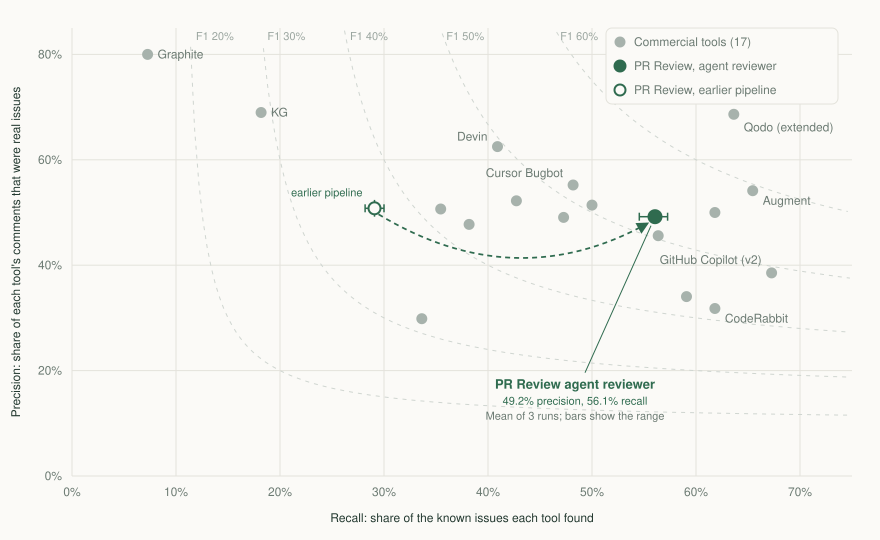

# Results

Measured October 1 and October 9, 2026 (America/Vancouver). Every number below comes from files in this repository; commands to reproduce them are at the end.

## Summary

- **Agent reviewer on a public benchmark.** On the 30 held-out pull requests of a 50-PR public benchmark, the agent reviewer found 56.1% of 110 human-verified issues at 49.2% precision, averaged over three runs (F1 52.4%; the runs scored 52.7%, 51.7% and 52.8%). In each run it ranks 4th of 18 reviewers scored by the same judge, behind Qodo (extended), Augment and Qodo. It is Claude Opus 5.5 in Claude Code with read-only tools, and this engine ties each finding to a changed line before publishing it.
- **Up from the model pipeline.** The October 1 model pipeline averaged 29.1% recall at 50.8% precision over three runs (F1 37.0%). The agent reviewer nearly doubled recall at about the same precision, and found 6 of 10 critical issues in every run where the pipeline found 1.
- **Two judges.** A second judge from another model family, Claude Sonnet 5.5, re-scored every reviewer. It agreed with the main GPT-5.5 judge on 97.7% of 2,832 decisions (Cohen's kappa 0.95) and also ranks the agent reviewer 4th on its three-run mean, at F1 53.0%.
- **Regression platform with a live model.** Across three runs over three seeded multi-file regressions and three valid alternative changes, it reproduced 9 of 9 regressions with failing tests, every proposed fix passed contract tests the agents never saw (9 of 9), and it flagged 0 of 9 valid changes.

## Public benchmark: 50 real pull requests

**Dataset.** [Martian's offline code review benchmark](https://github.com/withmartian/code-review-benchmark/tree/e616e849755441da38f18bf3adba2c9583b03803/offline), pinned at `e616e84`: 50 pull requests from Sentry, Grafana, Keycloak, Discourse and Cal.com with 173 human-verified issues ("golden comments"), 158 of them in the default *core* profile (bugs, security, concurrency, data, API, performance, test gaps and documentation defects). The reviewer never sees the golden comments, later fixes or discussion.

**Scoring.** An LLM judge decides whether each review comment describes the same underlying issue as a golden comment. Precision is matched comments over all comments, recall is found issues over all issues, and F1 combines them. Martian scores tools with GPT-5.2, which is not available through the ChatGPT subscription used here, so [`evals/martian/judge.py`](../evals/martian/judge.py) applies the same matching rule with one batched call per PR and tool (gpt-5.5, medium effort). Re-scoring the 17 published tools whose extracted comments Martian publishes, this judge agreed with Martian's published GPT-5.2 decisions on **95.5% of 2,941 golden-comment decisions (Cohen's kappa 0.91)**, and tool-level F1 typically lands within a few points of the published values. All tools below, including this reviewer, are scored by the same judge. A [second judge](#second-judge), Claude Sonnet 5.5, re-scored every held-out review as a check.

**Development and held-out split.** Before any change, the 50 PRs were split by a hash of their ID into 20 development PRs (4 per repository) and 30 held-out PRs ([`evals/martian/split.json`](../evals/martian/split.json)). Changes were chosen by looking at development PRs only. Held-out PRs measure each frozen configuration.

**Models.** The agent reviewer used claude-opus-5-5 at high effort in Claude Code 2.1.296. The model pipeline used gpt-6.1-sol at high reasoning effort through an OpenAI-compatible endpoint.

### Held-out results (30 PRs, core profile)



PR Review's two rows are means of three runs. The published tools are Martian's published runs, re-scored. The last column is F1 from the second judge.

| Rank | Reviewer | F1 | Precision | Recall | F1, second judge |
|---:|---|---:|---:|---:|---:|
| 1 | Qodo (extended) | 66.0% | 68.6% | 63.6% | 64.5% |
| 2 | Augment | 59.3% | 54.1% | 65.5% | 61.4% |
| 3 | Qodo | 55.3% | 50.0% | 61.8% | 55.5% |
| 4 | **PR Review, agent reviewer** | 52.4% | 49.2% | 56.1% | 53.0% |
| 5 | Cursor Bugbot | 51.5% | 55.2% | 48.2% | 52.7% |
| 6 | GitLab Duo | 50.7% | 51.4% | 50.0% | 50.9% |
| 7 | Gemini | 50.4% | 45.6% | 56.4% | 50.8% |
| 8 | Devin | 49.5% | 62.5% | 40.9% | 51.6% |
| 9 | GitHub Copilot (v2) | 49.0% | 38.5% | 67.3% | 50.5% |
| 10 | Greptile v4.1 | 48.1% | 49.1% | 47.3% | 48.4% |
| 11 | Macroscope | 47.0% | 52.2% | 42.7% | 49.0% |
| 12 | GitHub Copilot | 43.2% | 34.0% | 59.1% | 44.0% |
| 13 | Claude | 42.4% | 47.7% | 38.2% | 44.4% |
| 14 | CodeRabbit | 42.0% | 31.8% | 61.8% | 42.1% |
| 15 | Baz | 41.7% | 50.6% | 35.5% | 41.9% |
| 16 | **PR Review, model pipeline** | 37.0% | 50.8% | 29.1% | 39.0% |
| 17 | CodeAnt | 31.6% | 29.8% | 33.6% | 34.2% |
| 18 | KG | 28.8% | 69.0% | 18.2% | 30.2% |
| 19 | Graphite | 13.3% | 80.0% | 7.3% | 13.3% |

Strict profile (bugs, security, concurrency, data and API only), means of three runs: agent reviewer 51.6% F1 (47.7% precision, 56.3% recall) against 36.9% for the model pipeline.

Five published tools (cubic, Kodus, Sourcery, Claude Code and Greptile v5) are omitted: Martian publishes their extracted comments for at most one PR, so they cannot be re-scored comparably.

## Agent reviewer (October 9)

### A plain prompt to a stronger model

The model pipeline was precise but quiet: it found 30% of the known issues, and the leaders find over 60%. To see whether the pipeline or the model was the limit, the 30 held-out PRs went to current coding agents with a one-paragraph review request, read-only access to a checkout of the PR, and nothing else. Each ran once, as an untuned baseline:

| Reviewer (one held-out run) | Precision | Recall | F1 |
|---|---:|---:|---:|
| Claude Opus 5.5 in Claude Code, plain prompt | 49.0% | 65.5% | 56.0% |
| gpt-6.1-sol in `codex exec`, same prompt | 41.9% | 40.0% | 40.9% |
| `codex review`, gpt-6-astra | 45.8% | 34.5% | 39.4% |
| Model pipeline, October 1 (gpt-6.1-sol) | 52.4% | 30.0% | 38.2% |
| `codex review`, gpt-6.1-sol | 38.6% | 35.5% | 37.0% |
| Pipeline prompt in one model call (gpt-6.1-sol) | 54.3% | 22.7% | 32.1% |

The model made most of the difference. With the same prompt and the same read-only tools, Opus found 65.5% of the issues and gpt-6.1-sol found 40.0%. The plain gpt-6.1-sol agents landed within four F1 points of the pipeline built around the same model, so the pipeline's extra passes added little.

That changes what this project should own. Finding bugs is the model's job, and a strong agent that can read the repository does it best. The engine's job is everything around it: tying every comment to a line the PR changes, merging duplicates, deciding the verdict and publishing against the reviewed revision.

The plain Opus run was scored on held-out PRs before the agent reviewer existed, and it became the first of the agent reviewer's three held-out runs. Every design choice below was made on the development split.

### How the agent reviewer works

With `REVIEW_AGENT_CLI=claude` (or `codex`), `pr-review review` hands bug finding to a coding agent running in the local checkout. The agent receives the short review request and the command that shows the diff, and it gets read-only tools: file search and reads plus read-only `git` commands. It cannot edit files, run project code, use the network or see a GitHub credential. The engine parses its findings, keeps each one only when it cites a line the change edits, merges duplicates and applies the usual verdict and publication rules. [Configuration](guides/configuration.md#agent-reviewer).

### Development decisions (20 PRs, 48 issues)

| Development version | Precision | Recall | F1 | Decision |
|---|---:|---:|---:|---|
| Model pipeline, gpt-6.1-sol (October 1 final) | 42.4% | 29.2% | 34.6% | |
| Model pipeline, claude-opus-5-5 | 61.9% | 27.1% | 37.7% | Rejected: recall did not improve, and 3 of 20 reviews failed because the output stayed invalid after one correction |
| Model pipeline with exploration, claude-opus-5-5 | 37.8% | 29.2% | 32.9% | Rejected |
| Agent, its own locations | 31.0% | 45.8% | 37.0% | |
| Agent, exact changed lines | 35.2% | 39.6% | 37.3% | **Kept**: the same F1 with 14 fewer false positives (35 against 49) |
| Agent, within 3 lines of a change | 33.3% | 39.6% | 36.2% | Rejected |
| Agent, within 10 lines of a change | 32.8% | 39.6% | 35.8% | Rejected |
| Agent plus evidence validation | 40.7% | 22.9% | 29.3% | Rejected: removed 8 of 19 real issues along with 19 of 35 false ones; available behind `REVIEW_AGENT_VALIDATE` |
| Agent plus the Opus model pipeline, merged | 30.1% | 45.8% | 36.4% | Rejected |

Exact grounding became the default because an inline comment has to sit on a line the PR changes, and it matched the F1 of the agent's own locations with fewer unsupported comments. Reports: [`development-agent-report.json`](../evals/martian/results/development-agent-report.json).

### Three held-out runs

The frozen configuration then ran three times on the held-out PRs, and the model pipeline ran twice more so both have three runs.

| Configuration | Judge | Precision | Recall | F1, mean | F1 by run |
|---|---|---:|---:|---:|---|
| Agent reviewer (default) | GPT-5.5 | 49.2% | 56.1% | 52.4% | 52.7, 51.7, 52.8 |
| | Sonnet 5.5 | 49.9% | 56.7% | 53.0% | 52.9, 51.7, 54.5 |
| Agent, its own locations | GPT-5.5 | 48.2% | 62.7% | 54.5% | 56.2, 55.1, 52.2 |
| | Sonnet 5.5 | 48.7% | 63.0% | 54.9% | 56.5, 54.5, 53.8 |
| Model pipeline (gpt-6.1-sol) | GPT-5.5 | 50.8% | 29.1% | 37.0% | 38.2, 37.0, 35.8 |
| | Sonnet 5.5 | 53.7% | 30.6% | 39.0% | 40.7, 38.2, 38.2 |

- **Severity.** The agent reviewer found 6 of 10 critical issues in every run, where the pipeline found 1, and on average 27.7 of 42 high-severity issues against 20.3.
- **Grounding on held-out.** Exact-line grounding cost about two F1 points here: in each run it dropped 3 to 10 real issues whose comments pointed at code next to the change instead of an edited line. On the development split it cost nothing, and the default was not re-tuned on held-out results. Posting those findings in the review summary, instead of dropping them, is the next change to test on fresh development data.
- **The October 1 number.** The pipeline's original held-out run (38.2%) was the best of its three runs; the mean is 37.0%.
- **Volume, speed and cost.** Across 90 held-out reviews the agent proposed 423 findings and the engine kept 372 (88%), about 4 per PR. The median review took 49 seconds (90th percentile 91 seconds, over 60 live reviews), against 136 seconds for the pipeline. Claude Code reported an API-equivalent cost of $9.88 for the 30 reviews of the first run, a median of $0.26 per review.
- **One rerun.** One review (sentry-2, run 2) stalled for 11 minutes and was rerun once with the same configuration.

Reports: [`heldout-agent-report.json`](../evals/martian/results/heldout-agent-report.json).

### Second judge

GPT-5.5 stays the main judge. To check that the results do not depend on one model family, Claude Sonnet 5.5 (medium effort) re-scored every held-out review, including the 17 published tools, with the same prompt and matching rule. [`evals/martian/claude_judge_bridge.py`](../evals/martian/claude_judge_bridge.py) serves it to `judge.py` through `claude -p` with every tool turned off.

| Comparison | Decisions | Agreement | Cohen's kappa |
|---|---:|---:|---:|
| GPT-5.5 and Sonnet 5.5, 24 single-run reviewers | 2,832 | 97.7% | 0.95 |
| GPT-5.5 and Sonnet 5.5, the three-run experiments | 1,062 | 97.4% | 0.95 |
| GPT-5.5 and Martian's GPT-5.2, 17 published tools | 2,006 | 95.2% | 0.90 |
| Sonnet 5.5 and Martian's GPT-5.2, 17 published tools | 2,006 | 95.0% | 0.90 |

A decision is whether one reviewer found one golden issue on one PR. The two judges rank the 24 single-run reviewers almost identically (Spearman 0.99), and Sonnet is slightly more generous: it counted 1,232 matches where GPT-5.5 counted 1,213. Every reviewer's scores under both judges: [`heldout-two-judges-report.json`](../evals/martian/results/heldout-two-judges-report.json); agreement: [`second-judge-agreement.json`](../evals/martian/results/second-judge-agreement.json).

## Model pipeline (October 1)

The sections below record how the model pipeline was improved before the agent reviewer. Its first held-out run ranked 7th of 18 on precision and 15th on F1. The GitHub Action and App still use it, because they read pull requests through the API without a checkout.

### What changed, and how each change was decided

The baseline reviewer was precise but quiet. It reported about one finding per PR while the golden set averages three, and its recall was 22% on all 50 PRs. Scoring its unfiltered drafts showed that evidence validation discarded few drafts; the main pass simply never proposed most issues. Development experiments:

| Development version (20 PRs) | Precision | Recall | F1 | Decision |
|---|---:|---:|---:|---|
| Baseline | 38.9% | 14.6% | 21.2% | |
| One broad defect-hunting pass | 28.1% | 18.8% | 22.5% | Rejected: false positives doubled |
| Three focused hunts (logic, state, contracts) | 20.0% | 21.7% | 20.8% | Rejected (19 PRs scored); available behind `REVIEW_HUNT_STAGES`, off by default |
| Whole changed files in repository context | 35.7% | 20.8% | 26.3% | Kept |
| Plus: report concrete defects in code the PR edits | 42.4% | 29.2% | 34.6% | Kept, then frozen for the held-out run |

1. **Whole changed files in context.** Many misses needed the rest of the file: for example, a Keycloak cache method that calls back into the same caching layer instead of its delegate. The reviewer previously saw diff hunks plus at most 12 KiB of identifier-matched excerpts. Changed files now come first and appear whole when they fit, within a 40 KiB context budget that never displaces diff text.
2. **Edited defective code is in scope.** The reviewer deliberately ignored weaknesses that existed before the PR. For Cal.com, a PR made deletion callbacks `async` inside `forEach`, so their promises were still never awaited; the reviewer dismissed it because the base also discarded those promises. When a PR edits the defective expression itself, the reviewer and validator now report the concrete defect and say that the edited code carries it. Untouched pre-existing code stays out of scope.

### Repository exploration (opt-in, October 2)

The analysis above showed the reviewer never proposes most issues. One explanation was that it lacks the code a change depends on: the delegate a cache method should call, the route that names a parameter, the callers of a function whose return value changed. Leading tools explore the codebase, so `REVIEW_EXPLORE` adds an exploration step. Before the review, the model gets up to three rounds of at most eight lookups, each a case-sensitive fixed-string search or a file read centered on a symbol or line, answered from the PR's exact head revision with read-only `git grep` and `git show`. Excerpts it read join the review context as read-only, citable source. [`scripts/fetch-benchmark-sources.py`](../scripts/fetch-benchmark-sources.py) fetches only each benchmark PR's head commit (534 MB for all 50). The configuration was frozen on the development split, then run once on the held-out split.

| Version | Split | Precision | Recall | F1 | Model calls per review | Median review time |
|---|---|---:|---:|---:|---:|---:|
| Final (default) | Development (20 PRs) | 42.4% | 29.2% | 34.6% | 3.7 | 123 s |
| Exploration | Development | 41.7% | 31.2% | 35.7% | 6.7 | 220 s |
| Exploration plus logic hunt | Development | 34.8% | 33.3% | 34.0% | 9.2 | 379 s |
| Final (default) | Held-out (30 PRs) | 52.4% | 30.0% | 38.2% | 4.3 | 136 s |
| Exploration | Held-out | 49.3% | 32.7% | 39.3% | 7.7 | 231 s |

- Exploration found more issues on both splits (36 of 110 held-out issues against 33) at about three points lower held-out precision. F1 rose about one point on each split, which is within the run-to-run noise noted under Limitations. It stays off by default because it adds about 3.4 model calls and 95 seconds per review for a gain this experiment cannot separate from noise. It would rank 15th of 18 on held-out F1, the same place as the default.
- Adding the logic hunt found one more development issue and nine more false positives, repeating the earlier hunt result.
- Evidence validation kept 36 of 38 development drafts, so precision filtering is not what limits recall. The reviewer proposes about 1.8 findings per PR where the golden set averages 2.4, and it favors detailed edge cases over simple slips the golden set records, such as a function returning the unmodified config or a handler reading `params[:group_id]` when the route defines `:id`. Low-severity issues, which the review contract tells the model to skip, are 19 of the 33 development misses.
- The live runs exposed one defect. With more source in view, the validator once reported a defect other than the candidate it was checking, and the whole review failed. Validation now discards and notes anything other than its candidate, which keeps the rule that validation can never add a finding.
- One held-out review (discourse-4) hit a transient model failure and was rerun with the same configuration.

## Regression platform with a live model

The [platform](platform/quickstart.md) investigates a PR with three specialist agents, writes a regression test, runs it on the base and PR commits in a network-isolated container, has an independent agent judge intent, and proposes a fix that must pass the frozen test and the existing suite. `scripts/platform-live-eval.py` turns each [multi-file scenario](../examples/scenarios) into a Git mirror with a regression PR and a valid alternative PR, withholds the scenario's contract test from the platform, and uses it afterwards to check every proposed fix.

| Run (gpt-6.1-sol, high) | Regressions reproduced | Fixes passing withheld contract tests | Valid changes flagged |
|---|---:|---:|---:|
| 1 | 3 of 3 | 3 of 3 | 0 of 3 |
| 2 | 3 of 3 | 3 of 3 | 0 of 3 |
| 3 | 3 of 3 | 3 of 3 | 0 of 3 |

Raw records: [`evals/platform/runs/`](../evals/platform/runs). Earlier runs that exposed the problems below are kept in `evals/platform/runs/superseded/`.

Running live for the first time exposed four defects that scripted fixtures had hidden, each now fixed and tested:

- **Citations.** Models quote code correctly but miscount lines; one bad citation failed the whole review. Agents now receive numbered source, grounding tolerates whitespace and multi-line quotes and corrects lines that are off by up to three, and an ungroundable candidate is dropped with a reason instead of failing the review.
- **Retry classification.** A model outage was reported as invalid output and marked non-retryable. Outages are now retryable (503), so Temporal re-runs only the failed specialist; malformed output stays non-retryable (422).
- **Reproduction evidence.** Only `AssertionError` counted, so a regression that surfaced as the code's own `RuntimeError("cursor did not advance")` was marked inconclusive. Exceptions raised inside the reviewed source now count; syntax, import and name errors and exceptions thrown by the test itself still do not.
- **A mislabeled control.** The tenant-cache "valid" change stringified cache keys. The live run proved that tenant `1` and tenant `"1"` then share cached orders while storage keeps them apart: a real cross-tenant leak in the example. The control now uses a per-tenant cache.

## Limitations

- These are well-known open-source PRs, so they may appear in model training data. A fresh, consenting-repository set would be a stronger test.
- The agent reviewer and the model pipeline ran three times each on held-out PRs. Every other row ran once, including the published tools. Independent benchmark analyses report that gaps of a few F1 points between reviewers can be sampling or judge noise, and the agent reviewer's lead over 5th place (Cursor Bugbot, 51.5%) is within that range.
- The held-out split is no longer untouched for the agent reviewer, because its plain-prompt run was scored there before the design work. A larger benchmark is the next test; [`integrations/reviewbench`](../integrations/reviewbench) packages the agent reviewer for ReviewBench.
- The judges are models. They agree closely with each other and with Martian's published judge, but neither is a human adjudicator.
- The agent reviewer needs a local checkout and a signed-in Claude Code or Codex CLI. The GitHub Action and App read pull requests through the API and use the model pipeline.
- The platform scenarios are authored examples. The platform supports small UTF-8 Python repositories and progresses one candidate per review.
- Model pipeline runs used a ChatGPT subscription through a local OpenAI-compatible bridge to the Codex CLI. Reported token counts include that client's fixed system prompt, so no per-review dollar cost is claimed for them. Agent reviewer runs used a Claude subscription; the dollar figures above are Claude Code's API-equivalent estimates.

## Reproduce

```sh
npm ci && npm run build
npm run eval:import -- --limit 50            # freeze the 50 PRs (GitHub read access)
HELDOUT="$(python3 -c 'import json;print(",".join(json.load(open("evals/martian/split.json"))["heldout"]))')"

# Agent reviewer: fetch each PR's head commit, build main/pr workspaces, then review with Claude Code.
python3 scripts/fetch-benchmark-sources.py --into ~/.cache/pr-review-benchmark-sources
python3 scripts/prepare-benchmark-workspaces.py --sources ~/.cache/pr-review-benchmark-sources \
  --into ~/.cache/pr-review-benchmark-workspaces
REVIEW_AGENT_CLI=claude REVIEW_AGENT_CLI_MODEL=claude-opus-5-5 node scripts/compare-pipeline.mjs --dataset external \
  --cases "$HELDOUT" --limit 50 --arms agent-raw,agent --repeats 3 --concurrency 6 \
  --workspaces ~/.cache/pr-review-benchmark-workspaces

# Model pipeline.
export MODEL_GATEWAY_BASE_URL=... MODEL_GATEWAY_API_KEY=... REVIEW_AGENT_MODEL=...
node scripts/compare-pipeline.mjs --dataset external --cases "$HELDOUT" --limit 50 --arms context-validated --concurrency 10

# Score one run with any OpenAI-compatible judge endpoint and Martian's offline/ directory.
JUDGE_BASE_URL=... JUDGE_API_KEY=... python3 evals/martian/judge.py --benchmark <martian>/offline \
  --reviews evals/results/comparison-<id> --arm agent --name pr-review-agent --repetition 1 \
  --tools bugbot,coderabbit --out evals/martian/runs/mine
python3 evals/martian/summarize.py --published evals/martian/runs/published-tools/report.json --ours evals/martian/runs/mine/report.json --subset heldout

# Second judge: serve Claude Sonnet 5.5 through Claude Code and point the judge at it.
python3 evals/martian/claude_judge_bridge.py --port 8792 &
JUDGE_BASE_URL=http://127.0.0.1:8792/v1 JUDGE_API_KEY=local python3 evals/martian/judge.py --model claude-sonnet-5-5 \
  --benchmark <martian>/offline --reviews evals/results/comparison-<id> --arm agent --name pr-review-agent \
  --out evals/martian/runs/sonnet/mine

# Exploration arm of the model pipeline.
node scripts/compare-pipeline.mjs --dataset external --cases <ids> --arms context-explored --concurrency 10 \
  --sources ~/.cache/pr-review-benchmark-sources
```

Platform: start the services from [the quickstart](platform/quickstart.md) with a live provider, then run `uv run --project apps/platform python scripts/platform-live-eval.py --provider <alias>`.
