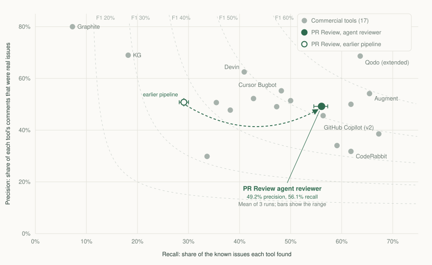
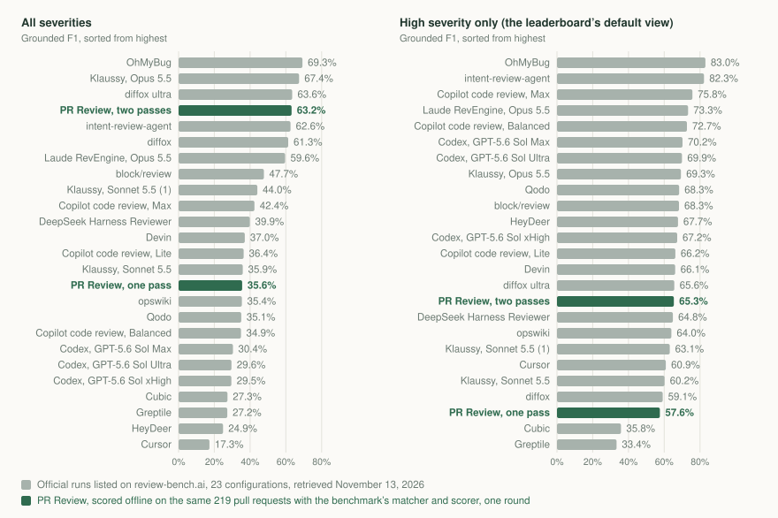

# Results

Measured October 1, October 9 and November 13, 2026 (America/Vancouver). Every number below comes from files in this repository; commands to reproduce them are at the end.

## Summary

- **Agent reviewer on a public benchmark.** On the 30 held-out pull requests of a 50-PR public benchmark, the agent reviewer found 56.1% of 110 human-verified issues at 49.2% precision, averaged over three runs (F1 52.4%; the runs scored 52.7%, 51.7% and 52.8%). Among 18 reviewers scored by the same judge it ranks 4th under two judges and 8th under a third, where five reviewers sit within 0.7 F1 points. Qodo (extended), Augment and Qodo lead under every judge. It is Claude Opus 5.5 in Claude Code with read-only tools, and this engine ties each finding to a changed line before publishing it.
- **Up from the model pipeline.** The October 1 model pipeline averaged 29.1% recall at 50.8% precision over three runs (F1 37.0%). The agent reviewer nearly doubled recall at about the same precision, and found 6 of 10 critical issues in every run where the pipeline found 1.
- **Three judges.** A second judge from another model family, Claude Sonnet 5.5, re-scored every reviewer. It agreed with the main GPT-5.5 judge on 97.7% of 2,832 decisions (Cohen's kappa 0.95) and also ranks the agent reviewer 4th on its three-run mean, at F1 53.0%. A third judge, gpt-6.1-sol, agreed with GPT-5.5 on 98.5% of 2,006 decisions and puts the agent reviewer at F1 51.0%, 8th.
- **More passes find more (November 13).** Three merged passes found 69.1% of the held-out issues, more than any of the 17 published tools, at the F1 of one pass. On [ReviewBench](#reviewbench-offline-november-13), where a pull request has 12 labelled true findings, one pass covers 22% of them. A second pass with a broad review request raised grounded F1 over all severities from 35.6 to 63.2 on all 219 pull requests, and from 34.3 to 61.1 on the 164 that no earlier run had reviewed. Placed among the 23 configurations on the public leaderboard, 63.2 is 4th of 24, and the highest is 69.3. On high-severity findings, the leaderboard's default view, it scored 65.3, which is 16th of 24. These are offline scores of one round with the benchmark's own matcher and scorer, and no official entry exists yet.
- **The benchmark adapter would have crashed on 29 of 219 pull requests.** The engine refused large diffs, binary files and very large files before the agent started. The adapter now reviews those too.
- **A decision model merges duplicates and cannot verify findings.** [Jev](../evals/decision-model/README.md) told whether two findings describe the same problem with AUC 0.992. Asked whether a finding is true, it scored the same with and without the code (AUC 0.869 and 0.868).
- **Regression platform with a live model.** Across three runs over three seeded multi-file regressions and three valid alternative changes, it reproduced 9 of 9 regressions with failing tests, every proposed fix passed contract tests the agents never saw (9 of 9), and it flagged 0 of 9 valid changes.

## Public benchmark: 50 real pull requests

**Dataset.** [Martian's offline code review benchmark](https://github.com/withmartian/code-review-benchmark/tree/e616e849755441da38f18bf3adba2c9583b03803/offline), pinned at `e616e84`: 50 pull requests from Sentry, Grafana, Keycloak, Discourse and Cal.com with 173 human-verified issues ("golden comments"), 158 of them in the default *core* profile (bugs, security, concurrency, data, API, performance, test gaps and documentation defects). The reviewer never sees the golden comments, later fixes or discussion.

**Scoring.** An LLM judge decides whether each review comment describes the same underlying issue as a golden comment. Precision is matched comments over all comments, recall is found issues over all issues, and F1 combines them. Martian scores tools with GPT-5.2, which is not available through the ChatGPT subscription used here, so [`evals/martian/judge.py`](../evals/martian/judge.py) applies the same matching rule with one batched call per PR and tool (gpt-5.5, medium effort). Re-scoring the 17 published tools whose extracted comments Martian publishes, this judge agreed with Martian's published GPT-5.2 decisions on **95.5% of 2,941 golden-comment decisions (Cohen's kappa 0.91)**, and tool-level F1 typically lands within a few points of the published values. All tools below, including this reviewer, are scored by the same judge. A [second judge](#second-judge), Claude Sonnet 5.5, re-scored every held-out review as a check.

**Development and held-out split.** Before any change, the 50 PRs were split by a hash of their ID into 20 development PRs (4 per repository) and 30 held-out PRs ([`evals/martian/split.json`](../evals/martian/split.json)). Changes were chosen by looking at development PRs only. Held-out PRs measure each frozen configuration.

**Models.** The agent reviewer used claude-opus-5-5 at high effort in Claude Code 2.1.296. The model pipeline used gpt-6.1-sol at high reasoning effort through an OpenAI-compatible endpoint.

### Held-out results (30 PRs, core profile)



PR Review's two rows are means of three runs. The published tools are Martian's published runs, re-scored. Rank, F1, precision and recall are from the GPT-5.5 judge. The last two columns are F1 from the [second](#second-judge) and [third](#third-judge-november-13) judges.

| Rank | Reviewer | F1 | Precision | Recall | F1, second judge | F1, third judge |
|---:|---|---:|---:|---:|---:|---:|
| 1 | Qodo (extended) | 66.0% | 68.6% | 63.6% | 64.5% | 62.3% |
| 2 | Augment | 59.3% | 54.1% | 65.5% | 61.4% | 59.8% |
| 3 | Qodo | 55.3% | 50.0% | 61.8% | 55.5% | 56.1% |
| 4 | **PR Review, agent reviewer** | 52.4% | 49.2% | 56.1% | 53.0% | 51.0% |
| 5 | Cursor Bugbot | 51.5% | 55.2% | 48.2% | 52.7% | 51.5% |
| 6 | GitLab Duo | 50.7% | 51.4% | 50.0% | 50.9% | 51.1% |
| 7 | Gemini | 50.4% | 45.6% | 56.4% | 50.8% | 51.4% |
| 8 | Devin | 49.5% | 62.5% | 40.9% | 51.6% | 51.6% |
| 9 | GitHub Copilot (v2) | 49.0% | 38.5% | 67.3% | 50.5% | 49.0% |
| 10 | Greptile v4.1 | 48.1% | 49.1% | 47.3% | 48.4% | 48.1% |
| 11 | Macroscope | 47.0% | 52.2% | 42.7% | 49.0% | 47.0% |
| 12 | GitHub Copilot | 43.2% | 34.0% | 59.1% | 44.0% | 43.0% |
| 13 | Claude | 42.4% | 47.7% | 38.2% | 44.4% | 43.4% |
| 14 | CodeRabbit | 42.0% | 31.8% | 61.8% | 42.1% | 41.4% |
| 15 | Baz | 41.7% | 50.6% | 35.5% | 41.9% | 42.6% |
| 16 | **PR Review, model pipeline** | 37.0% | 50.8% | 29.1% | 39.0% | not scored |
| 17 | CodeAnt | 31.6% | 29.8% | 33.6% | 34.2% | 31.6% |
| 18 | KG | 28.8% | 69.0% | 18.2% | 30.2% | 28.8% |
| 19 | Graphite | 13.3% | 80.0% | 7.3% | 13.3% | 13.3% |

Strict profile (bugs, security, concurrency, data and API only), means of three runs: agent reviewer 51.6% F1 (47.7% precision, 56.3% recall) against 36.9% for the model pipeline.

Five published tools (cubic, Kodus, Sourcery, Claude Code and Greptile v5) are omitted: Martian publishes their extracted comments for at most one PR, so they cannot be re-scored comparably.

## Agent reviewer (October 9)

### A plain prompt to a stronger model

The model pipeline was precise but quiet: it found 30% of the known issues, and the leaders find over 60%. To see whether the pipeline or the model was the limit, the 30 held-out PRs went to current coding agents with a one-paragraph review request, read-only access to a checkout of the PR, and nothing else. Each ran once, as an untuned baseline:

| Reviewer (one held-out run) | Precision | Recall | F1 |
|---|---:|---:|---:|
| Claude Opus 5.5 in Claude Code, plain prompt | 49.0% | 65.5% | 56.0% |
| gpt-6.1-sol in `codex exec`, same prompt | 41.9% | 40.0% | 40.9% |
| `codex review`, gpt-6-astra | 45.8% | 34.5% | 39.4% |
| Model pipeline, October 1 (gpt-6.1-sol) | 52.4% | 30.0% | 38.2% |
| `codex review`, gpt-6.1-sol | 38.6% | 35.5% | 37.0% |
| Pipeline prompt in one model call (gpt-6.1-sol) | 54.3% | 22.7% | 32.1% |

The model made most of the difference. With the same prompt and the same read-only tools, Opus found 65.5% of the issues and gpt-6.1-sol found 40.0%. The plain gpt-6.1-sol agents landed within four F1 points of the pipeline built around the same model, so the pipeline's extra passes added little.

That changes what this project should own. Finding bugs is the model's job, and a strong agent that can read the repository does it best. The engine's job is everything around it: tying every comment to a line the PR changes, merging duplicates, deciding the verdict and publishing against the reviewed revision.

The plain Opus run was scored on held-out PRs before the agent reviewer existed, and it became the first of the agent reviewer's three held-out runs. Every design choice below was made on the development split.

### How the agent reviewer works

With `REVIEW_AGENT_CLI=claude` (or `codex`), `pr-review review` hands bug finding to a coding agent running in the local checkout. The agent receives the short review request and the command that shows the diff, and it gets read-only tools: file search and reads plus read-only `git` commands. It cannot edit files, run project code, use the network or see a GitHub credential. The engine parses its findings, keeps each one only when it cites a line the change edits, merges duplicates and applies the usual verdict and publication rules. [Configuration](guides/configuration.md#agent-reviewer).

### Development decisions (20 PRs, 48 issues)

| Development version | Precision | Recall | F1 | Decision |
|---|---:|---:|---:|---|
| Model pipeline, gpt-6.1-sol (October 1 final) | 42.4% | 29.2% | 34.6% | |
| Model pipeline, claude-opus-5-5 | 61.9% | 27.1% | 37.7% | Rejected: recall did not improve, and 3 of 20 reviews failed because the output stayed invalid after one correction |
| Model pipeline with exploration, claude-opus-5-5 | 37.8% | 29.2% | 32.9% | Rejected |
| Agent, its own locations | 31.0% | 45.8% | 37.0% | |
| Agent, exact changed lines | 35.2% | 39.6% | 37.3% | **Kept**: the same F1 with 14 fewer false positives (35 against 49) |
| Agent, within 3 lines of a change | 33.3% | 39.6% | 36.2% | Rejected |
| Agent, within 10 lines of a change | 32.8% | 39.6% | 35.8% | Rejected |
| Agent plus evidence validation | 40.7% | 22.9% | 29.3% | Rejected: removed 8 of 19 real issues along with 19 of 35 false ones; available behind `REVIEW_AGENT_VALIDATE` |
| Agent plus the Opus model pipeline, merged | 30.1% | 45.8% | 36.4% | Rejected |

Exact grounding became the default because an inline comment has to sit on a line the PR changes, and it matched the F1 of the agent's own locations with fewer unsupported comments. Reports: [`development-agent-report.json`](../evals/martian/results/development-agent-report.json).

### Three held-out runs

The frozen configuration then ran three times on the held-out PRs, and the model pipeline ran twice more so both have three runs.

| Configuration | Judge | Precision | Recall | F1, mean | F1 by run |
|---|---|---:|---:|---:|---|
| Agent reviewer (default) | GPT-5.5 | 49.2% | 56.1% | 52.4% | 52.7, 51.7, 52.8 |
| | Sonnet 5.5 | 49.9% | 56.7% | 53.0% | 52.9, 51.7, 54.5 |
| Agent, its own locations | GPT-5.5 | 48.2% | 62.7% | 54.5% | 56.2, 55.1, 52.2 |
| | Sonnet 5.5 | 48.7% | 63.0% | 54.9% | 56.5, 54.5, 53.8 |
| Model pipeline (gpt-6.1-sol) | GPT-5.5 | 50.8% | 29.1% | 37.0% | 38.2, 37.0, 35.8 |
| | Sonnet 5.5 | 53.7% | 30.6% | 39.0% | 40.7, 38.2, 38.2 |

- **Severity.** The agent reviewer found 6 of 10 critical issues in every run, where the pipeline found 1, and on average 27.7 of 42 high-severity issues against 20.3.
- **Grounding on held-out.** Exact-line grounding cost about two F1 points here: in each run it dropped 3 to 10 real issues whose comments pointed at code next to the change instead of an edited line. On the development split it cost nothing, and the default was not re-tuned on held-out results. Posting those findings in the review summary, instead of dropping them, is the next change to test on fresh development data.
- **The October 1 number.** The pipeline's original held-out run (38.2%) was the best of its three runs; the mean is 37.0%.
- **Volume, speed and cost.** Across 90 held-out reviews the agent proposed 423 findings and the engine kept 372 (88%), about 4 per PR. The median review took 49 seconds (90th percentile 91 seconds, over 60 live reviews), against 136 seconds for the pipeline. Claude Code reported an API-equivalent cost of $9.88 for the 30 reviews of the first run, a median of $0.26 per review.
- **One rerun.** One review (sentry-2, run 2) stalled for 11 minutes and was rerun once with the same configuration.

Reports: [`heldout-agent-report.json`](../evals/martian/results/heldout-agent-report.json).

### Second judge

GPT-5.5 stays the main judge. To check that the results do not depend on one model family, Claude Sonnet 5.5 (medium effort) re-scored every held-out review, including the 17 published tools, with the same prompt and matching rule. [`evals/martian/claude_judge_bridge.py`](../evals/martian/claude_judge_bridge.py) serves it to `judge.py` through `claude -p` with every tool turned off.

| Comparison | Decisions | Agreement | Cohen's kappa |
|---|---:|---:|---:|
| GPT-5.5 and Sonnet 5.5, 24 single-run reviewers | 2,832 | 97.7% | 0.95 |
| GPT-5.5 and Sonnet 5.5, the three-run experiments | 1,062 | 97.4% | 0.95 |
| GPT-5.5 and Martian's GPT-5.2, 17 published tools | 2,006 | 95.2% | 0.90 |
| Sonnet 5.5 and Martian's GPT-5.2, 17 published tools | 2,006 | 95.0% | 0.90 |

A decision is whether one reviewer found one golden issue on one PR. The two judges rank the 24 single-run reviewers almost identically (Spearman 0.99), and Sonnet is slightly more generous: it counted 1,232 matches where GPT-5.5 counted 1,213. Every reviewer's scores under both judges: [`heldout-two-judges-report.json`](../evals/martian/results/heldout-two-judges-report.json); agreement: [`second-judge-agreement.json`](../evals/martian/results/second-judge-agreement.json).

## More passes and a third judge (November 13)

The agent reviewer makes one pass with a short request. This section measures what more passes add on two benchmarks that score a long review in opposite ways, and it re-scores the October results with a third judge. The agent used claude-opus-5-5 at high effort in Claude Code 2.1.321, and claude-sonnet-5-5 where named.

### Third judge (November 13)

GPT-5.5 is no longer served to the ChatGPT subscription used here, so new results on this benchmark need another judge. gpt-6.1-sol at high effort re-scored the 17 published tools and the three held-out runs of the agent reviewer with the same prompt and matching rule.

| Comparison, 17 published tools | Decisions | Agreement | Cohen's kappa |
|---|---:|---:|---:|
| gpt-6.1-sol and GPT-5.5 | 2,006 | 98.5% | 0.97 |
| gpt-6.1-sol and Sonnet 5.5 | 2,006 | 97.5% | 0.95 |
| gpt-6.1-sol and Martian's GPT-5.2 | 2,006 | 95.3% | 0.91 |

Under this judge the agent reviewer scores F1 51.0% (47.9% precision, 54.5% recall; the runs scored 51.0, 50.0 and 51.9) and ranks 8th of 18. Devin (51.6%), Cursor Bugbot (51.5%), Gemini (51.4%) and GitLab Duo (51.1%) are within 0.7 points above it. Qodo (extended), Augment and Qodo keep the first three places under all three judges. Behind them, the order of the next five reviewers depends on the judge. Report: [`heldout-third-judge-report.json`](../evals/martian/results/heldout-third-judge-report.json).

### The broad review request

The plain request asks for "the bugs and problems this pull request introduces that the author should fix before merging". A strong agent answers with about five serious findings and stops. The broad request asks for every distinct problem in the code the pull request adds or changes. It names what to check in each changed file (correctness, security, performance, interface design, tests, documentation, maintainability and accessibility) and says to include medium and low priority problems. It was written after reading what five plain passes missed on ReviewBench's test set. `REVIEW_AGENT_BREADTH_RUNS` adds broad passes to a review, and the engine merges their findings with the plain passes ([configuration](guides/configuration.md#thorough-reviews)).

### More passes on the held-out pull requests

The three held-out runs were merged into one review, and one broad pass was added. gpt-6.1-sol judged each configuration once.

| Configuration, findings on changed lines | Findings per PR | Precision | Recall | F1 |
|---|---:|---:|---:|---:|
| One plain pass, mean of three runs | 4.2 | 47.9% | 54.5% | 51.0% |
| Three plain passes merged | 6.3 | 40.0% | 69.1% | 50.7% |
| One plain pass and one broad pass | 12.5 | 22.3% | 76.4% | 34.6% |
| Three plain passes and one broad pass | 13.3 | 21.6% | 78.2% | 33.9% |

- **Three merged passes found 76 of the 110 issues.** The highest recall among the 17 published tools under this judge is 67.3% (GitHub Copilot v2, at 38.5% precision). F1 stayed at the level of one pass.
- **The broad pass found 84 of the 110 issues**, and 92 at the agent's own locations, while precision fell to 22%. This benchmark lists 3.7 issues per pull request and counts every other finding as false, so a review with 12 findings scores low precision on it.
- **Changed-line grounding.** For the three merged passes it removed 38 findings that matched no issue and none that matched one. With the broad pass it removed 77 unmatched findings and 8 matched ones.

### ReviewBench, offline (November 13)

**Dataset.** [ReviewBench](https://github.com/review-bench/ReviewBench/tree/4c9fc63c4a72a46291bc61a9eecf0efd5d7c6106), pinned at `4c9fc63`: 219 pull requests from 187 repositories. Each has a golden set of review findings, and each golden finding is labelled a true or false positive with a severity. The public test set has 25 pull requests with 352 true positives (36 high, 134 medium and 182 low severity) and 213 false positives. That is 14 true findings per pull request, half of them low severity.

**Scoring.** The benchmark's own matcher and scorer, run locally by [`evals/reviewbench`](../evals/reviewbench/README.md) with Claude Sonnet 5, the benchmark's judge model. Grounded precision is the share of matched findings whose golden finding is a true positive. Grounded recall is the share of true-positive golden findings that some finding covers. A finding that matches no golden finding counts neither for nor against precision. The leaderboard ranks by grounded F1 and shows it in three views: high-severity findings only (its default), high and medium severity, and all severities.

**Method.** Every agent answer was saved. All findings of all runs of one kind went to the matcher once, as a pool, and each configuration was then composed from the pools and scored for every choice of runs. "One plain pass and one broad pass", for example, is the mean over the 10 pairs of one of 5 plain passes and one of 2 broad passes. Findings keep the agent's own locations, as in the [adapter](../integrations/reviewbench/README.md). Precision, recall and the first F1 column cover all severities. Cost is Claude Code's API-equivalent figure, the mean over the saved reviews.

#### Test set (25 pull requests)

| Configuration | Findings per PR | Precision | Recall | F1 | F1, high and medium severity | F1, high severity | Cost per PR |
|---|---:|---:|---:|---:|---:|---:|---:|
| One plain pass (default) | 4.8 | 91.4% | 25.6% | 40.0% | 59.6% | 67.2% | $0.36 |
| Three plain passes | 10.0 | 90.2% | 34.5% | 49.9% | 69.2% | 73.0% | $1.09 |
| Five plain passes | 13.1 | 89.9% | 38.4% | 53.8% | 72.6% | 74.5% | $1.81 |
| One broad pass | 15.5 | 82.7% | 51.7% | 63.6% | 76.5% | 68.9% | $0.56 |
| One broad pass, Sonnet 5.5 | 15.8 | 78.4% | 50.0% | 61.1% | 70.6% | 71.4% | $0.23 |
| One plain pass and one broad pass | 18.1 | 83.1% | 53.9% | 65.4% | 79.0% | 74.2% | $0.92 |
| One plain pass and two broad passes | 26.4 | 81.4% | 60.7% | 69.6% | 82.4% | 78.1% | $1.47 |
| One plain pass and two Sonnet 5.5 broad passes | 31.4 | 77.0% | 64.9% | 70.4% | 81.9% | 79.2% | $0.82 |
| Three plain passes and two Sonnet 5.5 broad passes | 34.9 | 77.2% | 66.5% | 71.5% | 83.5% | 82.0% | $1.54 |
| Five plain, two broad and two Sonnet 5.5 broad passes | 49.6 | 76.5% | 73.0% | 74.7% | 87.3% | 86.2% | $3.38 |

- **One plain pass stops early.** It reports 4.8 findings per pull request at 91.4% precision and covers a quarter of the true findings. Its five runs scored F1 between 37.1 and 42.4.
- **Repeating the request helps slowly.** Five merged passes cover 38.4%. None of the five reported 213 of the 352 true findings: 14 of 36 with high severity, 57 of 134 with medium and 142 of 182 with low.
- **A different request finds what repetition does not.** One broad pass covers 51.7% at 82.7% precision, more than five plain passes at a third of the cost.
- **A cheaper model does the broad passes.** Two Sonnet 5.5 broad passes cover more than two Opus 5.5 broad passes (63.1% against 59.7%) at 41% of the cost, with 4 points less precision.
- **High-severity findings need both requests.** One plain pass covers 51.7% of them and one broad pass 54.2%; together they cover 60.8%. The plain pass is already aimed at serious defects, so the broad pass adds most among medium and low severity findings.
- **Changed-line grounding costs recall here.** Keeping only findings on a line the change edits lowered the F1 of single passes by 3 to 6 points, because ReviewBench matches findings by file. The adapter keeps the agent's own locations by default. Publication to GitHub still ties every comment to a changed line.

All 20 configurations: [`test-set.json`](../evals/reviewbench/results/test-set.json).

#### Fresh sample (30 pull requests)

The broad request was written from the test set's misses, so the test set cannot confirm it. Thirty of the other 194 pull requests were drawn before any run: the first 30 when sorted by SHA-256 of their key ([`fresh-sample.json`](../evals/reviewbench/fresh-sample.json)). They have 392 true positives (20 high, 154 medium and 218 low severity). Each pass ran once.

| Configuration | Findings per PR | Precision | Recall | F1 | F1, high and medium severity | F1, high severity | Cost per PR |
|---|---:|---:|---:|---:|---:|---:|---:|
| One plain pass (default) | 4.4 | 89.8% | 23.7% | 37.5% | 47.8% | 64.3% | $0.43 |
| One broad pass | 16.7 | 85.8% | 55.9% | 67.7% | 75.1% | 64.3% | $0.76 |
| One plain pass and one broad pass | 19.3 | 85.1% | 58.9% | 69.6% | 77.4% | 66.7% | $1.19 |

The fresh sample repeats the test set on all severities: one plain pass covers a quarter of the true findings, and adding one broad pass raises F1 by 32 points. On high severity the gain is 2 points here and 7 on the test set. The fresh sample has 20 high-severity true findings and the test set 36, so one finding moves that recall by 3 to 5 points. Numbers: [`fresh-sample.json`](../evals/reviewbench/results/fresh-sample.json).

#### The adapter's own output

The tables above compose reviews from pooled matcher decisions. As a check, the adapter's code built the findings file for one plain pass and one broad pass from the saved answers, and the matcher judged those files directly ([`adapter-path.json`](../evals/reviewbench/results/adapter-path.json)).

| Sample | Findings per PR | Precision | Recall | F1 | Composed from pools |
|---|---:|---:|---:|---:|---:|
| Test set, 25 PRs | 18.0 | 85.5% | 54.0% | 66.2% | 65.4% |
| Fresh sample, 30 PRs | 18.6 | 85.1% | 59.9% | 70.3% | 69.6% |

#### All 219 pull requests

The last run covers the whole benchmark. Its setup was [committed before it started](../evals/reviewbench/full-run.json): Claude Opus 5.5 at high effort in Claude Code 2.1.321, one round, the default configuration (one plain pass) and the thorough one (one plain pass and one broad pass), scored on the findings file the adapter writes. The 55 pull requests above kept their first saved answers. The other 164 were reviewed once for each kind of pass. No earlier run had reviewed them, so they are the check on settings that were chosen on the test set.

The 219 pull requests have 2,623 true findings: 181 high, 891 medium and 1,551 low severity ([`full-run.json`](../evals/reviewbench/results/full-run.json)).

| Pull requests | Configuration | Findings per PR | Precision | Recall | F1 | F1, high and medium severity | F1, high severity | Cost per PR |
|---|---|---:|---:|---:|---:|---:|---:|---:|
| All 219 | One plain pass | 4.0 | 87.8% | 22.3% | 35.6% | 50.3% | 57.6% | $0.41 |
| All 219 | One plain and one broad pass | 15.7 | 82.1% | 51.4% | **63.2%** | **72.1%** | **65.3%** | $1.06 |
| The 164 not reviewed before | One plain pass | 3.8 | 86.5% | 21.4% | 34.3% | 48.7% | 53.8% | $0.42 |
| The 164 not reviewed before | One plain and one broad pass | 14.8 | 80.7% | 49.1% | 61.1% | 69.8% | 64.5% | $1.06 |

The second pass holds on the 164 new pull requests: F1 over all severities rose from 34.3 to 61.1, and high-severity F1 from 53.8 to 64.5. The test set and the fresh sample scored higher than the rest (66.2 and 70.3 against 61.1), so the number for all 219 is the one to quote. Every one of the 438 reviews gave an answer. Two reached the 13-minute limit on the first try and finished on the second. The median review took 48 seconds for the plain pass and 85 seconds for the broad pass.

#### Beside the leaderboard

The [public leaderboard](https://review-bench.ai) holds official runs over the same 219 pull requests, three rounds for most entries. It lists 23 configurations, and its default view counts high-severity findings only. The chart places this reviewer's offline scores among them in two of the leaderboard's three views. The leaderboard's numbers were [retrieved on November 13](../evals/reviewbench/results/leaderboard-2026-11-13.json).



The table holds eight of the 23 listed configurations and this reviewer's two.

| Reviewer | Findings per PR | F1, all severities | F1, high and medium severity | F1, high severity |
|---|---:|---:|---:|---:|
| OhMyBug | 37.1 | 69.3% | 81.7% | 83.0% |
| intent-review-agent | 17.6 | 62.6% | 79.0% | 82.2% |
| GitHub Copilot code review, Max | 7.1 | 42.4% | 61.4% | 75.7% |
| Laude RevEngine, Claude Opus 5.5 | 11.4 | 59.6% | 71.8% | 73.3% |
| Klaussy, Claude Opus 5.5 | 25.9 | 67.4% | 75.0% | 69.3% |
| Qodo | 4.7 | 35.1% | 54.5% | 68.3% |
| Devin | 5.0 | 37.0% | 54.4% | 66.1% |
| Cursor | 1.8 | 17.3% | 32.5% | 60.9% |
| **PR Review, one plain pass (offline)** | 4.0 | 35.6% | 50.3% | 57.6% |
| **PR Review, one plain and one broad pass (offline)** | 15.7 | 63.2% | 72.1% | 65.3% |

Placed among the 23 listed configurations, the two-pass reviewer is 4th of 24 on all severities, behind OhMyBug, Klaussy with Claude Opus 5.5 and diffox ultra (63.6%). It is 5th of 24 on high and medium severity and 16th of 24 on high severity. One plain pass is 14th, 17th and 22nd. The second pass adds most where a pull request has many medium and low findings. On high-severity findings recall rose from 40.9% to 50.8%, and the first two entries on the list find about 75%.

The PR Review rows are offline measurements of one round, with the same matcher model and scorer. Only an official run gives this reviewer a place on that list.

#### The adapter refused 29 of 219 pull requests

Running the adapter's code over the first 55 checkouts showed that the engine refused 10 of them before the agent started: 3 diffs over 1 MiB, 3 changes with a binary file and 4 with one file too large for a model message. Over all 219 pull requests it refused 29. In a benchmark run each would have produced no findings file. The engine indexes the diff to tie findings to changed lines, and the agent does not need that index, because it reads the checkout itself. The adapter now reviews such a pull request anyway and keeps the agent's own locations ([`review-pull-request.mjs`](../integrations/reviewbench/review-pull-request.mjs)). The command line still refuses these changes, because publication needs the index.

### Decision model

A decision model answers typed questions with probabilities and writes no text. [Two experiments](../evals/decision-model/README.md) with Jev on the ReviewBench test set measured the two jobs it could do in this reviewer.

- **Verifying a finding: no.** Asked whether each of 565 labelled findings is a true positive, it scored AUC 0.869 with the diff and file in view and 0.868 with only the finding's text. Knowing which tool wrote the finding scores 0.862. It ranks writing style.
- **Detecting duplicates: yes.** On 1,701 labelled pairs of findings from different passes it scored AUC 0.992, with 95.2% precision at 92.8% recall. The engine's rule (same file, at most three lines apart, shared title words) reaches 98.3% precision at 50.2% recall.
- **End to end.** Merging five plain passes with the model left 8.4 findings per pull request, where the rule leaves 13.1, and cost 1.2 points of recall. The whole run cost $0.07 for 2,695 pairs. The engine keeps its rule, which needs no extra service.

## Model pipeline (October 1)

The sections below record how the model pipeline was improved before the agent reviewer. Its first held-out run ranked 7th of 18 on precision and 15th on F1. The GitHub Action and App still use it, because they read pull requests through the API without a checkout.

### What changed, and how each change was decided

The baseline reviewer was precise but quiet. It reported about one finding per PR while the golden set averages three, and its recall was 22% on all 50 PRs. Scoring its unfiltered drafts showed that evidence validation discarded few drafts; the main pass simply never proposed most issues. Development experiments:

| Development version (20 PRs) | Precision | Recall | F1 | Decision |
|---|---:|---:|---:|---|
| Baseline | 38.9% | 14.6% | 21.2% | |
| One broad defect-hunting pass | 28.1% | 18.8% | 22.5% | Rejected: false positives doubled |
| Three focused hunts (logic, state, contracts) | 20.0% | 21.7% | 20.8% | Rejected (19 PRs scored); available behind `REVIEW_HUNT_STAGES`, off by default |
| Whole changed files in repository context | 35.7% | 20.8% | 26.3% | Kept |
| Plus: report concrete defects in code the PR edits | 42.4% | 29.2% | 34.6% | Kept, then frozen for the held-out run |

1. **Whole changed files in context.** Many misses needed the rest of the file: for example, a Keycloak cache method that calls back into the same caching layer instead of its delegate. The reviewer previously saw diff hunks plus at most 12 KiB of identifier-matched excerpts. Changed files now come first and appear whole when they fit, within a 40 KiB context budget that never displaces diff text.
2. **Edited defective code is in scope.** The reviewer deliberately ignored weaknesses that existed before the PR. For Cal.com, a PR made deletion callbacks `async` inside `forEach`, so their promises were still never awaited; the reviewer dismissed it because the base also discarded those promises. When a PR edits the defective expression itself, the reviewer and validator now report the concrete defect and say that the edited code carries it. Untouched pre-existing code stays out of scope.

### Repository exploration (opt-in, October 2)

The analysis above showed the reviewer never proposes most issues. One explanation was that it lacks the code a change depends on: the delegate a cache method should call, the route that names a parameter, the callers of a function whose return value changed. Leading tools explore the codebase, so `REVIEW_EXPLORE` adds an exploration step. Before the review, the model gets up to three rounds of at most eight lookups, each a case-sensitive fixed-string search or a file read centered on a symbol or line, answered from the PR's exact head revision with read-only `git grep` and `git show`. Excerpts it read join the review context as read-only, citable source. [`scripts/fetch-benchmark-sources.py`](../scripts/fetch-benchmark-sources.py) fetches only each benchmark PR's head commit (534 MB for all 50). The configuration was frozen on the development split, then run once on the held-out split.

| Version | Split | Precision | Recall | F1 | Model calls per review | Median review time |
|---|---|---:|---:|---:|---:|---:|
| Final (default) | Development (20 PRs) | 42.4% | 29.2% | 34.6% | 3.7 | 123 s |
| Exploration | Development | 41.7% | 31.2% | 35.7% | 6.7 | 220 s |
| Exploration plus logic hunt | Development | 34.8% | 33.3% | 34.0% | 9.2 | 379 s |
| Final (default) | Held-out (30 PRs) | 52.4% | 30.0% | 38.2% | 4.3 | 136 s |
| Exploration | Held-out | 49.3% | 32.7% | 39.3% | 7.7 | 231 s |

- Exploration found more issues on both splits (36 of 110 held-out issues against 33) at about three points lower held-out precision. F1 rose about one point on each split, which is within the run-to-run noise noted under Limitations. It stays off by default because it adds about 3.4 model calls and 95 seconds per review for a gain this experiment cannot separate from noise. It would rank 15th of 18 on held-out F1, the same place as the default.
- Adding the logic hunt found one more development issue and nine more false positives, repeating the earlier hunt result.
- Evidence validation kept 36 of 38 development drafts, so precision filtering is not what limits recall. The reviewer proposes about 1.8 findings per PR where the golden set averages 2.4, and it favors detailed edge cases over simple slips the golden set records, such as a function returning the unmodified config or a handler reading `params[:group_id]` when the route defines `:id`. Low-severity issues, which the review contract tells the model to skip, are 19 of the 33 development misses.
- The live runs exposed one defect. With more source in view, the validator once reported a defect other than the candidate it was checking, and the whole review failed. Validation now discards and notes anything other than its candidate, which keeps the rule that validation can never add a finding.
- One held-out review (discourse-4) hit a transient model failure and was rerun with the same configuration.

## Regression platform with a live model

The [platform](platform/quickstart.md) investigates a PR with three specialist agents, writes a regression test, runs it on the base and PR commits in a network-isolated container, has an independent agent judge intent, and proposes a fix that must pass the frozen test and the existing suite. `scripts/platform-live-eval.py` turns each [multi-file scenario](../examples/scenarios) into a Git mirror with a regression PR and a valid alternative PR, withholds the scenario's contract test from the platform, and uses it afterwards to check every proposed fix.

| Run (gpt-6.1-sol, high) | Regressions reproduced | Fixes passing withheld contract tests | Valid changes flagged |
|---|---:|---:|---:|
| 1 | 3 of 3 | 3 of 3 | 0 of 3 |
| 2 | 3 of 3 | 3 of 3 | 0 of 3 |
| 3 | 3 of 3 | 3 of 3 | 0 of 3 |

Raw records: [`evals/platform/runs/`](../evals/platform/runs). Earlier runs that exposed the problems below are kept in `evals/platform/runs/superseded/`.

### Java with Maven and JUnit (November 10)

The [retry-backoff scenario](../examples/scenarios/retry-backoff) is a Maven project with JUnit 5 tests. Its regression PR replaces a saturating backoff helper with `baseMillis << attempt`, which overflows into negative delays and wraps at attempt 64 because Java masks the shift distance. Its valid PR rewrites the helper as a saturating doubling loop. `ContractTest.java` is withheld and runs in the sandbox image against every proposed fix.

| Run (gpt-6.1-sol, high) | Regression reproduced with a JUnit test (time to approval step) | Fix passing withheld contract test | Valid change flagged |
|---|---:|---:|---:|
| 1 | yes, 1.7 min | yes | no |
| 2 | yes, 1.3 min | yes | no |
| 3 | yes, 1.5 min | yes | no |

In each run, the model wrote its own public JUnit class. The sandbox built it with Maven, offline and without network, and ran it on both commits. It passed on base and failed on the PR, for example with `expected: <PT30S> but was: <PT-2562047788015H-12M-55.808S>` at attempt 63. [The run transcript](results/2026-11-10-java-maven.md) has the test, the Surefire evidence, the validator's reason and the proposed patch.

An earlier run on the same day flagged the "valid" PR, and the platform was right. The first version of the scenario accepted a base delay under one millisecond, such as `Duration.ofNanos(1)`, which truncates to 0 ms. The original helper still saturated to the maximum at attempt 63. The rewritten loop doubled zero forever, so it returned 0 and ran 2,147,483,647 iterations for `delayFor(Integer.MAX_VALUE)`. The scenario now rejects bases under one millisecond in every variant. That run, and three runs on a runner build with a since-fixed stack-frame filter, are kept in `evals/platform/runs/superseded/`.

Running live for the first time exposed four defects that scripted fixtures had hidden, each now fixed and tested:

- **Citations.** Models quote code correctly but miscount lines; one bad citation failed the whole review. Agents now receive numbered source, grounding tolerates whitespace and multi-line quotes and corrects lines that are off by up to three, and an ungroundable candidate is dropped with a reason instead of failing the review.
- **Retry classification.** A model outage was reported as invalid output and marked non-retryable. Outages are now retryable (503), so Temporal re-runs only the failed specialist; malformed output stays non-retryable (422).
- **Reproduction evidence.** Only `AssertionError` counted, so a regression that surfaced as the code's own `RuntimeError("cursor did not advance")` was marked inconclusive. Exceptions raised inside the reviewed source now count; syntax, import and name errors and exceptions thrown by the test itself still do not.
- **A mislabeled control.** The tenant-cache "valid" change stringified cache keys. The live run proved that tenant `1` and tenant `"1"` then share cached orders while storage keeps them apart: a real cross-tenant leak in the example. The control now uses a per-tenant cache.

## Limitations

- These are well-known open-source PRs, so they may appear in model training data. A fresh, consenting-repository set would be a stronger test.
- The agent reviewer and the model pipeline ran three times each on held-out PRs. Every other row ran once, including the published tools. Independent benchmark analyses report that gaps of a few F1 points between reviewers can be sampling or judge noise, and the agent reviewer's lead over 5th place (Cursor Bugbot, 51.5%) is within that range.
- The held-out split is no longer untouched for the agent reviewer, because its plain-prompt run was scored there before the design work. A larger benchmark is the next test; [`integrations/reviewbench`](../integrations/reviewbench) packages the agent reviewer for ReviewBench.
- The judges are models. They agree closely with each other and with Martian's published judge, but none is a human adjudicator.
- The ReviewBench scores are offline and self-scored: grounded metrics only, with the matcher model served through Claude Code at low effort. The run over all 219 pull requests is one round, where most official entries are the mean of three, and two of its 438 reviews ran again after they reached the time limit, which an official run does not do. The other configurations were measured on 25 test pull requests and 30 others, most of them composed from pooled matcher decisions. The benchmark's official run is the test that counts, and it has not been made.
- The broad review request was written from the ReviewBench test set's misses. The fresh sample and the 164 pull requests of the last run are the check on it, and the Martian held-out result shows the cost: on a benchmark that counts every unlisted finding as false, the broad pass lowers F1 by 16 points.
- The multi-pass configurations on the Martian held-out set were each judged once, by one judge. The three merged passes are the same three runs reported one by one above.
- With a diff over 1 MiB, a binary file or one very large file, the command line still refuses to review. Only the ReviewBench adapter reviews such changes, because it does not need changed-line grounding.
- The agent reviewer needs a local checkout and a signed-in Claude Code or Codex CLI. The GitHub Action and App read pull requests through the API and use the model pipeline.
- The platform scenarios are authored examples. The platform supports small UTF-8 Python repositories and Maven projects with JUnit 5, whose dependencies must be cached in the runner image, and progresses one candidate per review. The Java result covers one scenario.
- Model pipeline runs used a ChatGPT subscription through a local OpenAI-compatible bridge to the Codex CLI. Reported token counts include that client's fixed system prompt, so no per-review dollar cost is claimed for them. Agent reviewer runs used a Claude subscription; the dollar figures above are Claude Code's API-equivalent estimates.

## Reproduce

```sh
npm ci && npm run build
npm run eval:import -- --limit 50            # freeze the 50 PRs (GitHub read access)
HELDOUT="$(python3 -c 'import json;print(",".join(json.load(open("evals/martian/split.json"))["heldout"]))')"

# Agent reviewer: fetch each PR's head commit, build main/pr workspaces, then review with Claude Code.
python3 scripts/fetch-benchmark-sources.py --into ~/.cache/pr-review-benchmark-sources
python3 scripts/prepare-benchmark-workspaces.py --sources ~/.cache/pr-review-benchmark-sources \
  --into ~/.cache/pr-review-benchmark-workspaces
REVIEW_AGENT_CLI=claude REVIEW_AGENT_CLI_MODEL=claude-opus-5-5 node scripts/compare-pipeline.mjs --dataset external \
  --cases "$HELDOUT" --limit 50 --arms agent-raw,agent --repeats 3 --concurrency 6 \
  --workspaces ~/.cache/pr-review-benchmark-workspaces

# Model pipeline.
export MODEL_GATEWAY_BASE_URL=... MODEL_GATEWAY_API_KEY=... REVIEW_AGENT_MODEL=...
node scripts/compare-pipeline.mjs --dataset external --cases "$HELDOUT" --limit 50 --arms context-validated --concurrency 10

# Score one run with any OpenAI-compatible judge endpoint and Martian's offline/ directory.
JUDGE_BASE_URL=... JUDGE_API_KEY=... python3 evals/martian/judge.py --benchmark <martian>/offline \
  --reviews evals/results/comparison-<id> --arm agent --name pr-review-agent --repetition 1 \
  --tools bugbot,coderabbit --out evals/martian/runs/mine
python3 evals/martian/summarize.py --published evals/martian/runs/published-tools/report.json --ours evals/martian/runs/mine/report.json --subset heldout

# Second judge: serve Claude Sonnet 5.5 through Claude Code and point the judge at it.
python3 evals/martian/claude_judge_bridge.py --port 8792 &
JUDGE_BASE_URL=http://127.0.0.1:8792/v1 JUDGE_API_KEY=local python3 evals/martian/judge.py --model claude-sonnet-5-5 \
  --benchmark <martian>/offline --reviews evals/results/comparison-<id> --arm agent --name pr-review-agent \
  --out evals/martian/runs/sonnet/mine

# Exploration arm of the model pipeline.
node scripts/compare-pipeline.mjs --dataset external --cases <ids> --arms context-explored --concurrency 10 \
  --sources ~/.cache/pr-review-benchmark-sources
```

November 13: the third judge is the same `judge.py` command with `--model gpt-6.1-sol --effort high` against an OpenAI-compatible endpoint that serves that model. The multi-pass arms add `REVIEW_AGENT_RUNS=3` or `REVIEW_AGENT_BREADTH_RUNS=1` to the agent reviewer command above. ReviewBench: [`evals/reviewbench/README.md`](../evals/reviewbench/README.md). Decision model: [`evals/decision-model/README.md`](../evals/decision-model/README.md).

Platform: start the services from [the quickstart](platform/quickstart.md) with a live provider, then run `uv run --project apps/platform python scripts/platform-live-eval.py --provider <alias>`.
